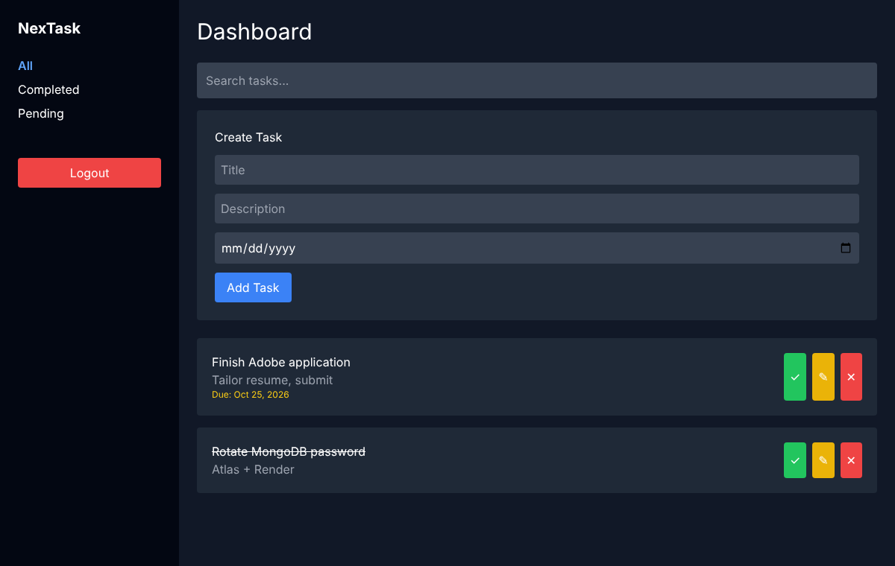
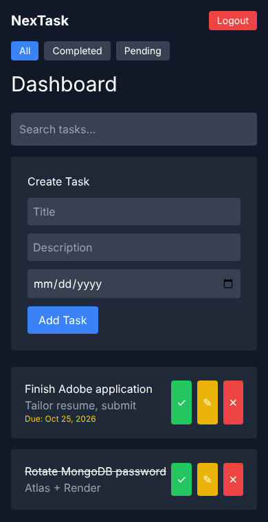

# NexTask

A full-stack task manager: sign up, log in, and create, edit, complete, search and filter your own tasks with due dates. Each user sees only their own tasks.

**Stack:** React 19, React Router, Tailwind CSS, Axios (frontend) · Node.js, Express 5, MongoDB with Mongoose, JWT authentication, bcrypt (backend) · Jest, Supertest, React Testing Library (tests)

| Desktop | Phone |
| :---: | :---: |
|  |  |

---

## Features

- Sign-up and login with hashed passwords (bcrypt) and 7-day JWT sessions
- Task create, read, update and delete, each with a title, description, due date and done/pending state
- Search by title and filter by All / Completed / Pending, on desktop (sidebar) and phones (top bar)
- Protected routes: logged-out visitors are sent to login, and an expired token logs you out automatically
- Errors shown on the page (wrong password, server down) instead of browser pop-ups

## Architecture

```
React (Netlify) ──HTTPS + Bearer token──► Express API (Render) ──Mongoose──► MongoDB Atlas
  src/pages/*.js                           server/routes/*.js
  src/services/api.js                      server/middleware/authMiddleware.js
                                           server/models/{User,Task}.js
```

## API

All task routes need the header `Authorization: Bearer <token>`.

| Method | Endpoint | Body | Returns |
| :--- | :--- | :--- | :--- |
| POST | `/api/auth/register` | `username, email, password` (6+ chars) | user + token (201) |
| POST | `/api/auth/login` | `email, password` | user + token |
| GET | `/api/tasks` | | your tasks, newest first |
| POST | `/api/tasks` | `title`, optional `description, dueDate, completed` | new task (201) |
| GET | `/api/tasks/:id` | | one task |
| PUT | `/api/tasks/:id` | any of `title, description, dueDate, completed` | updated task |
| DELETE | `/api/tasks/:id` | | `{ message }` |
| GET | `/api/health` | | `{ status: "ok" }` |

Another user's task, or a malformed id, returns **404**, so the API never reveals which task ids exist. Only the four fields above can be changed; anything else in the body (such as `user`) is ignored.

## Run locally

Requires Node.js 20+ and a MongoDB connection string (free tier on [MongoDB Atlas](https://www.mongodb.com/atlas)).

```bash
# 1. Backend
cd server
npm install
cp .env.example .env      # then fill in MONGO_URI and JWT_SECRET
npm run dev               # http://localhost:5000

# 2. Frontend (new terminal, project root)
npm install
cp .env.example .env.local   # points the app at http://localhost:5000/api
npm start                    # http://localhost:3000
```

## Tests

```bash
cd server && npm test                     # 23 API tests: auth, CRUD, ownership, validation, CORS
npm test -- --watchAll=false              # frontend routing tests
```

The API tests need no database: they swap Mongoose's storage for an in-memory fake while keeping the real schemas, so validation and type rules behave as in production. GitHub Actions runs both suites and a production build on every push.

## Deploy

- **Backend: Render.** New → Blueprint → this repo (uses `render.yaml`). In Environment, set `MONGO_URI`, `JWT_SECRET` and `CLIENT_ORIGIN` (your Netlify URL).
- **Frontend: Netlify.** Import the repo; `netlify.toml` sets the build. Add the environment variable `REACT_APP_API_URL=https://<your-render-app>.onrender.com/api`.
- **Database: MongoDB Atlas.** Under Network Access, allow `0.0.0.0/0`, since Render's free tier has no fixed IP.

Render's free tier sleeps after about 15 minutes idle, so the first request after a pause can take 30–60 seconds.

## What changed in the October 2026 hardening pass

| Problem | Fix |
| :--- | :--- |
| `server/.env` (database password, JWT secret) was committed to GitHub | Removed from the repo, `.gitignore` updated, secrets rotated |
| The auth middleware logged every token **and the JWT secret** | Logging removed; a test fails if either appears in logs |
| Updating a task passed the whole request body to MongoDB, so a user could change a task's owner | Only `title, description, dueDate, completed` are accepted |
| Due dates were sent by the app but never saved (no `dueDate` in the schema) | Field added, plus date formatting in the UI |
| Malformed ids and bad dates crashed requests with 500 errors | Return 404 / 400 |
| No sign-up page, although the API supported it | `/register` page added |
| Filters and logout were hidden on phones | Mobile top bar added |
| Port hard-coded to 5000, CORS open to every site, a `/test-db` route listed collections | `PORT` from the host, CORS limited to `CLIENT_ORIGIN`, route removed |
| `package-lock.json` out of sync, so `npm ci` (used by CI and Netlify) failed | Lock file regenerated |
| `server/node_modules` (1,669 files) and a broken `client` submodule were committed | Removed from the repo and ignored |
